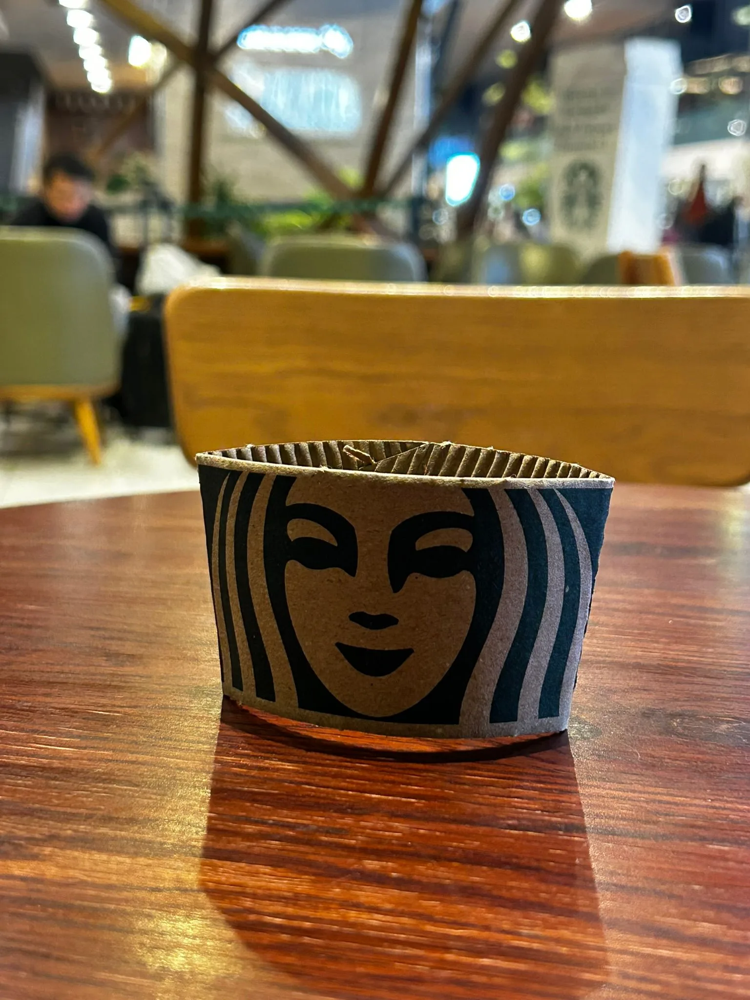
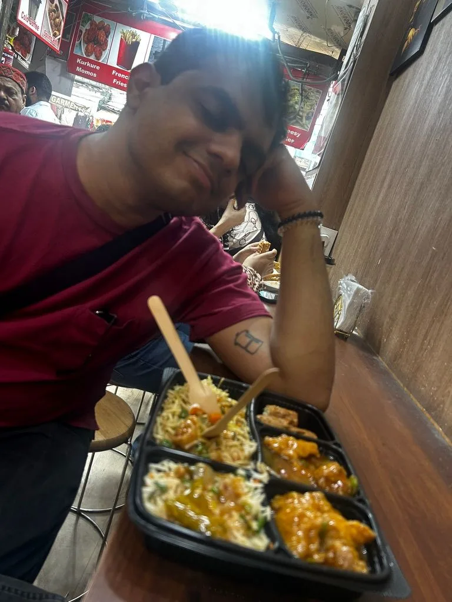
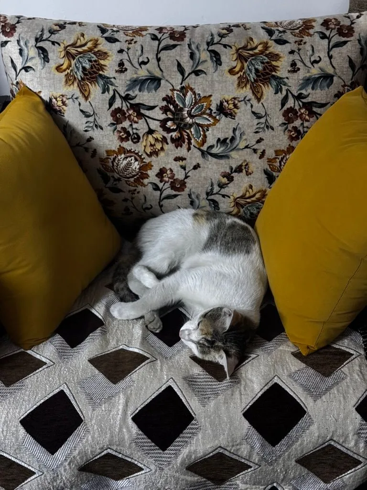

> **Day**: One
> **Date**: 14 November, 2026

***

## Morning

- Started the day at 3 am to catch a Delhi flight for my sister’s wedding on the 20th of November. Slept through the whole flight and cab journey like a log.
- There was no time for coffee at home, and we were too late to make a stop at the Blue Tokai outside the airport. Settled for a Starbucks americano after the security check-in instead, which was disappointing at best. Should have just carried a coffee sachet and asked for hot water instead.
- The smell of the air pollution reached us the moment we landed in Delhi and the flight doors opened. We had our masks up for the rest of the day.

## Afternoon

- Day one continued at full speed with a shopping trip to Lajpat Nagar to get jewellery and accessories for my sister’s wedding outfits.
- The early start and lack of sleep started catching up with me. Ended up taking a mini-nap while sitting on a bench right in the middle of the market.
- My elder cousin has gone for a live-on-the-edge shopping spree for the wedding. She went to pick up a mehendi outfit and came back with a completely new one for the reception. Her entire plan is now being revised!

## Evening

- Finally met _Aamchur_, the stray cat who lives with my parents. Loves head scratches! **Fun fact**: Aamchur’s name was inspired by _Imli_, another stray cat who lived with my parents some years ago.
- My dad reached out for my hand today and held it intertwined in his for a while. This is the first time he has done this in my conscious memory. Last year’s heart attack has softened him up, and I am glad for it.
- Had to skip the rest of the week’s planning and turn in early. I will need all the energy I can muster!
