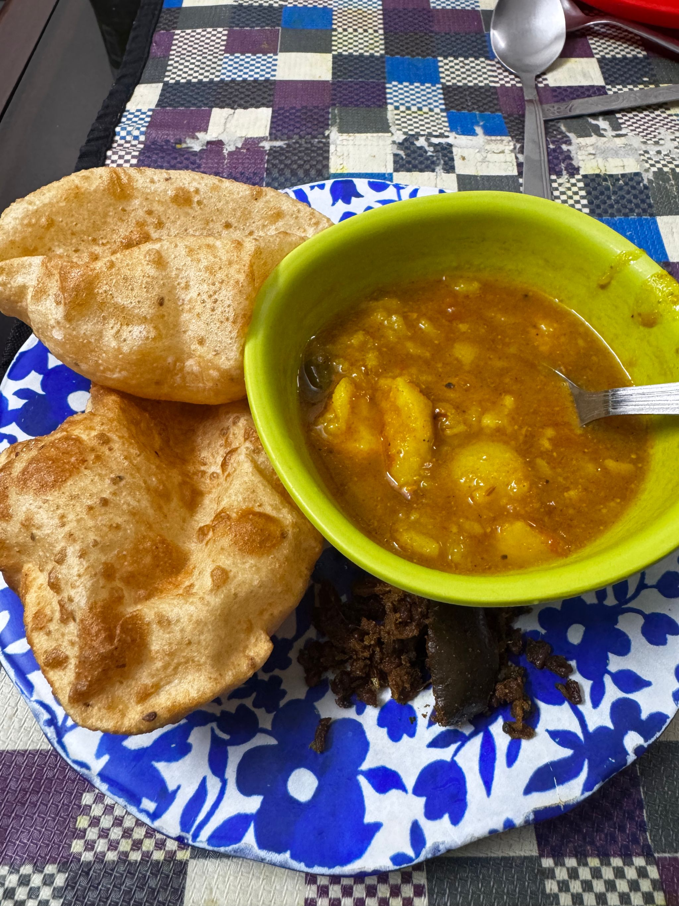
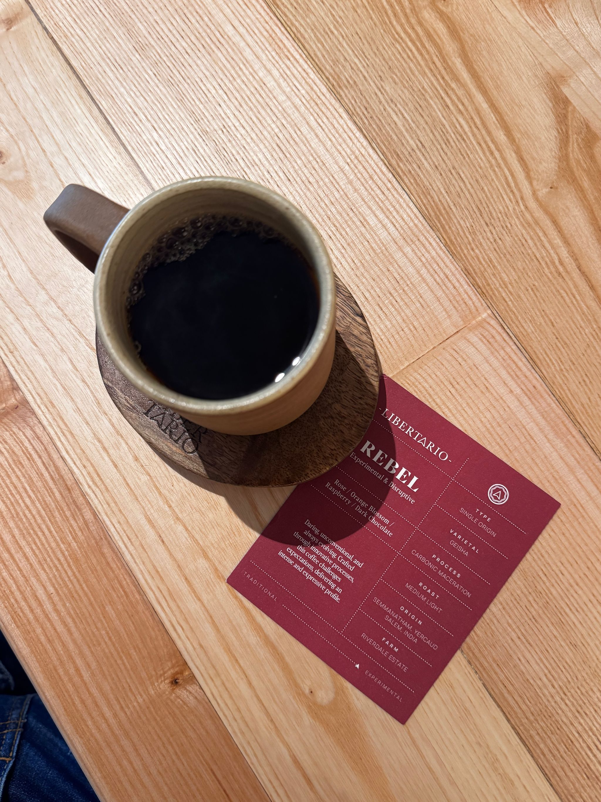
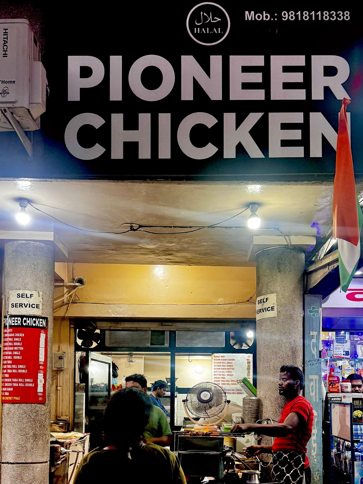

> **Day**: Two
> **Date**: 15 November, 2026

***

## Morning

- Had a quiet start to the morning with Shaoni at the Airbnb we booked near our house for the wedding week. This place has afforded us some slow mornings which usually are a pipe dream in a wedding home.
- Finally met the neighbourhood dogs. The street we live on has always had a dozen or so dogs roaming around. They’re now in their third generation. Love these idiots!
- Breakfast was aloo-poori. Now the induction back home is finally over.

## Afternoon

- A little over 24 hours in Delhi, and the family has started losing their shit over random stuff every five minutes. A group of undiagnosed anxious chaos merchants.
- Visited the hotel and venue hall booked for the wedding day. My favourite part always is trying the food they bring down to the office from another event happening at the venue. Dahi ke kebab!
- Shaoni and I sneaked in a mini-date in all the commotion. Got to drink one of my favourite coffees, and make a stop at a beloved bookstore.

## Evening

- Letting you in on a Delhi secret about the best mutton roll in town. No trip to Delhi is ever complete without having at least two of these.
- Using household chores as the perfect excuse to get some steps in and see how the neighbourhood I grew up in changes year after year.
- The day ended with deciding the lunch and dinner menus for the wedding day. Through all the disagreements in the selection process, a Punjabi family is always in sync about the dessert preferences.
