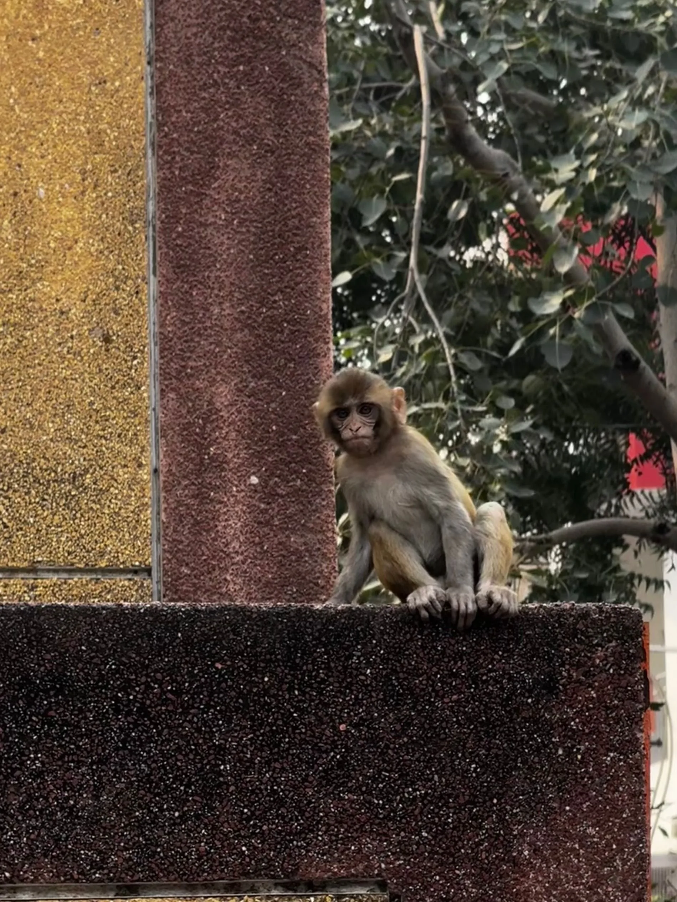
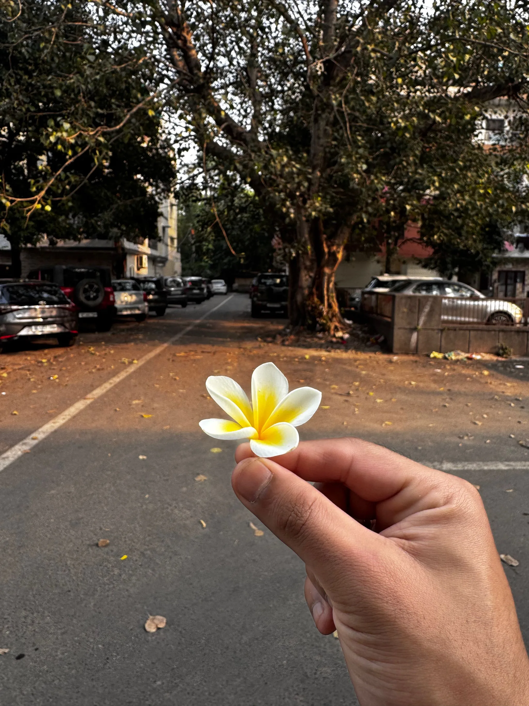
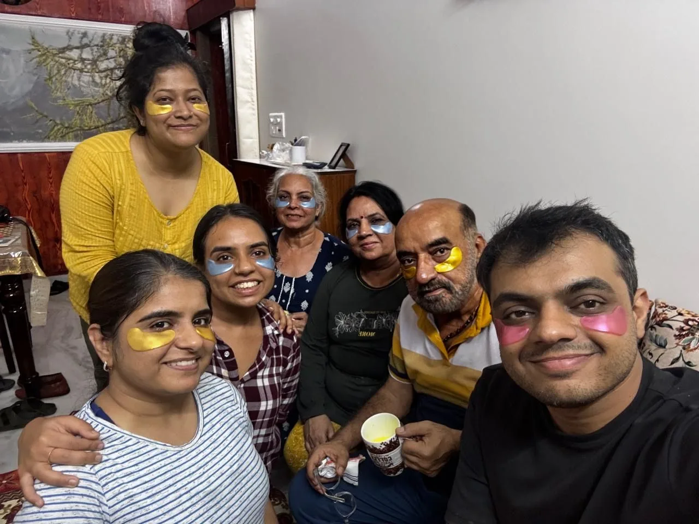

> **Day**: Three
> **Date**: 16 November, 2026

***

## Morning

- Waking up to a lot of body aches over the last two days. My middle-aged body needs more time between adventures now.
- There might be a small break in the regular wedding programming over today and tomorrow. Have to earn that paycheck for all the nice wedding clothes.
- The only animal more common than dogs are the monkeys in my neighbourhood. They are everywhere, and will be found eating fruits on your dining table if you do not close the gate after you.

## Afternoon

- The change in weather and air is not going well for the family. People are falling sick like dominoes, and everyone permanently has a scratchy throat.
- Shaoni gave me a flower on our walk today. I am happy! 🙂
- Finally met another sister after so many years, along with my three-year-old nephew. So much living, growing and changing happens on another continent, and you only get to see glimpses of it.

## Evening

- We have been packing, unpacking and moving clothes for the past three days. There is some semblance of a clothing plan for most people now.
- My dad took me along to invite some neighbours to the wedding. Turns out, he did not know their first or last names and ended up asking them on the spot so we could write them a card! I truly do not understand their generation’s logic behind inviting people to a wedding.
- The wedding week prep is getting serious now!
