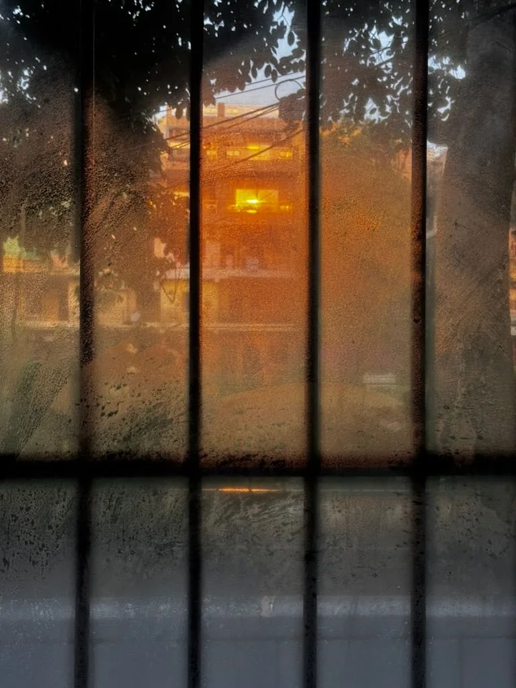
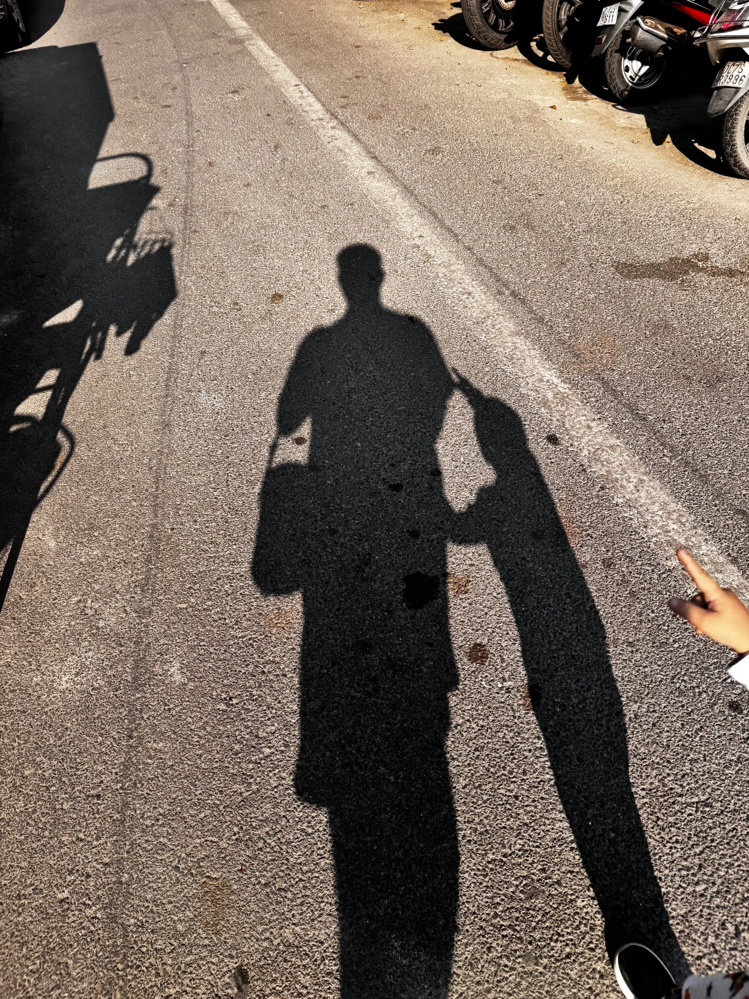
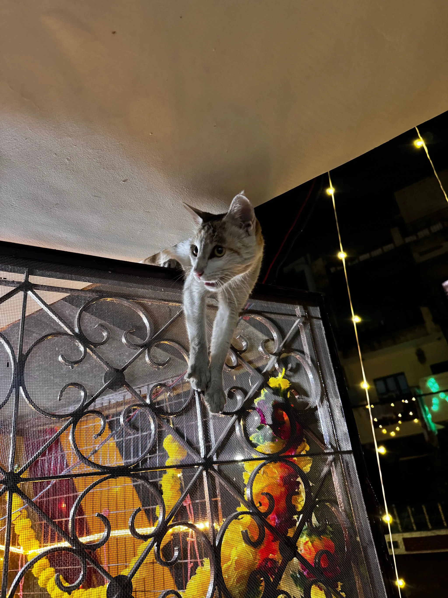

> **Day**: Four
> **Date**: 17 November, 2026

***

# Morning

- It is finally starting to feel like winter in Delhi. The mornings are a little chilly, and I am considering not wearing shorts anymore. Better late than never.
- Today’s breakfast was aloo ke paranthe. An hour later, I am still thinking about the tasty parantha covered in ghee and butter.
- Couple of downsides to living at the Airbnb. First, every meal means a walk to the house and then back to the room, especially on a workday like today. Second, as the wedding gets closer, all the fun conversations are happening at home.

# Afternoon

* Took my industrially curious nephew for a walk after lunch.
* My cough is getting progressively worse in the pollution. The lump and scratching in my throat feel very unpleasant.
* Delhi has brought back evening coffees for me, hopefully just temporarily. I need all the caffeine I can get to survive all the overstimulation.

# Evening

- This evening’s walk with Shaoni led to gol gappes for her and a Dairy Milk for yours truly.
- Aamchur has spent the entire day complaining about being stuck above our gate while refusing all help to actually come down.
- Balloons were filled with air; faces were filled with dessert. Perfect way to end the day.
