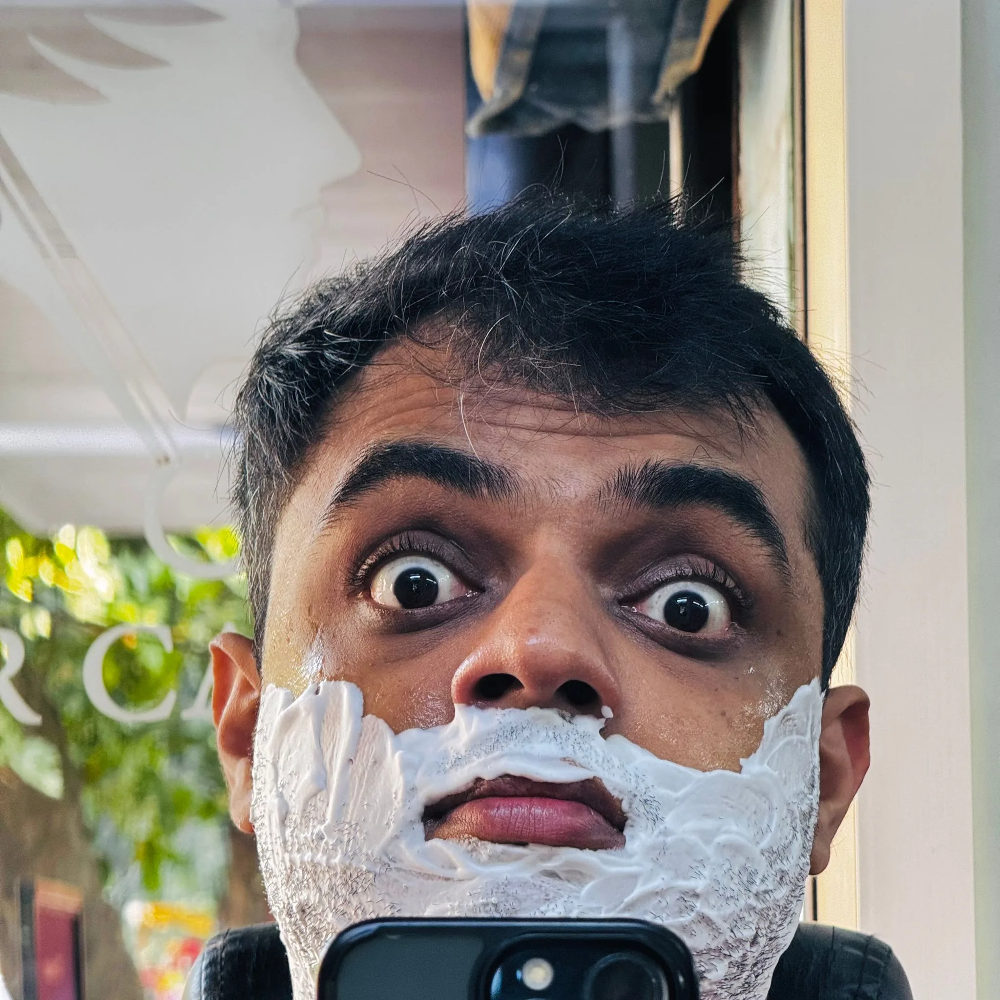
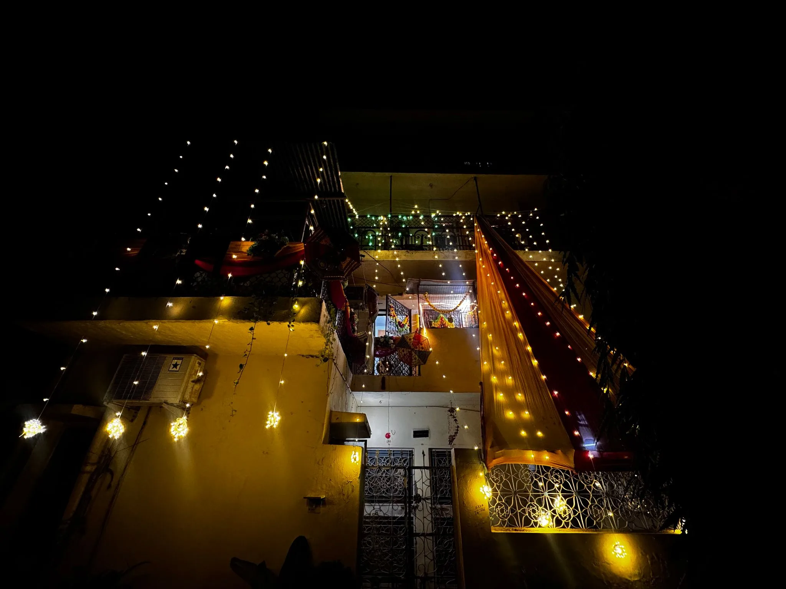

> **Day**: Five
> **Date**: 18 November, 2026

***

# Morning

- T-minus two days to the wedding. It feels like the airplane is on the runway now, picking up speed. Things are coming at us left, right and centre.
- Missed my morning pages for the first time after 39 days straight. Feeling a little annoyed. Do not like carrying so many thoughts in my head through the day.
- Needed a shave, but scared to use the razor myself. Went to the neighbourhood barber I used to visit as a kid. Good to see familiar faces again.

# Afternoon

- Gave myself the gift of a little nap and a lot of quiet after driving around all morning.
- Had a party for my sister (with lots of games and snacks).
- Went around clicking photos of everyone. This is the first time I have used my camera with the family. Unfortunately, no good photos of me from the day, though. Hopefully tomorrow.

# Evening

* The wedding lights are up on the house, and it looks beautiful.
* Mom caught a bad cough and did not take much care of herself. Now she cannot stop coughing, and we are out at 10 pm looking for a doctor. Sigh.
* Had to go receive some guests at 11 in the night. I am exhausted. Shaoni ordered us a midnight snack from Khan Chacha to recover from the day.
