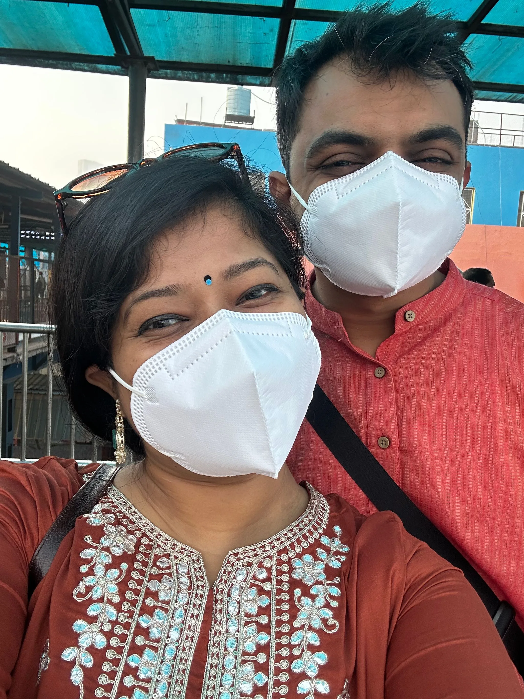
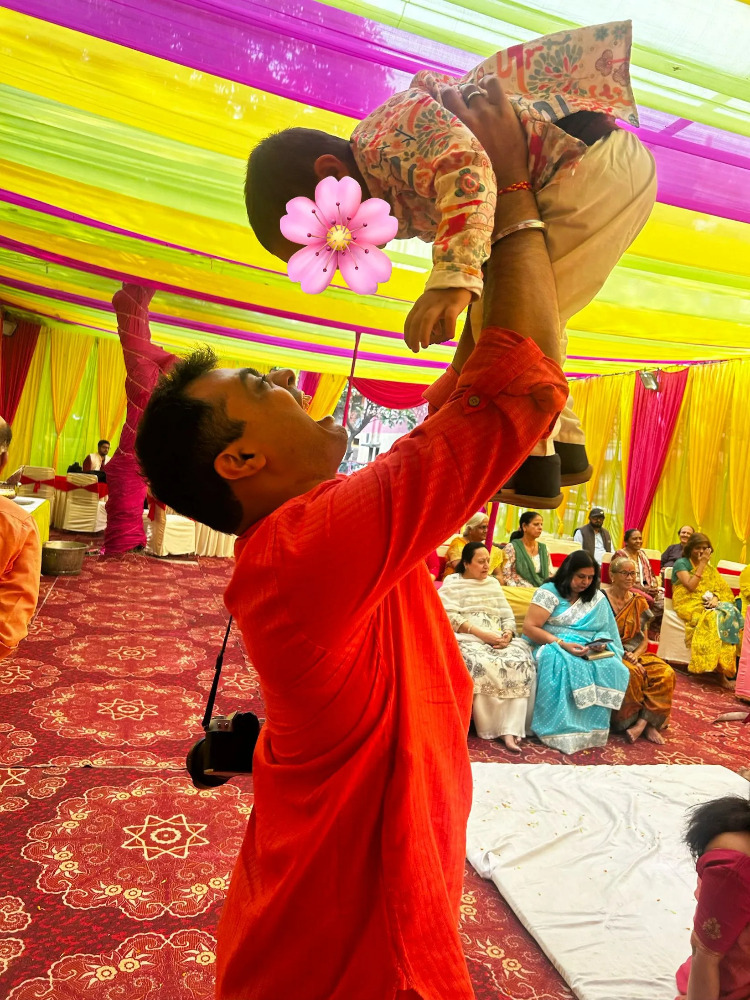
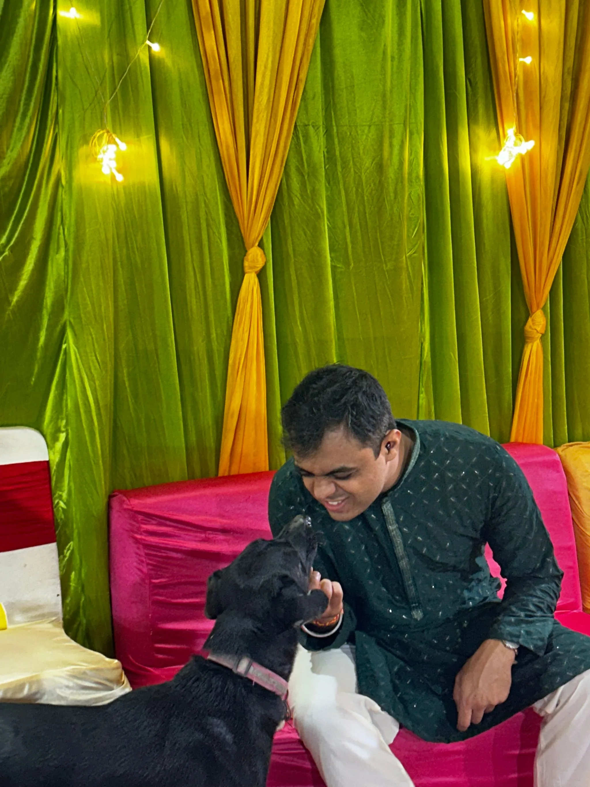

> **Day**: Six
> **Date**: 19 November, 2026

***

# Morning

- T-minus one day to the main event. The tents are up, and the professional photographers are here. The wedding officially begins today.
- Picked up Shaoni’s parents from the station. Sneaked in another mini-date on the way back!
- Today’s random snack while doing wedding chores: McDonald’s. I am a sucker for the Pizza McPuff.

# Afternoon

* Spent most of the afternoon playing with (read: distracting) my extremely high-energy nephew. Apparently, keeping a three-year-old entertained is also a wedding duty.
* Three stages of pooja music before any Punjabi wedding. First bhajan, then folk music, and finally full-on Bollywood.
* A quick nap, a coffee and recharged camera batteries. Next up, Mehendi.

# Evening

* Wedding jitters are getting to people. Everyone is panicking and nobody seems to have a plan. Getting a little exhausting.
* Danced my heart out for the first time in years. All one needs is the nostalgia of the music they grew up with, no matter how good or bad.
* The rest of the evening was spent stuffing our faces and passing around drinks in paper cups. A very discreet operation, considering everyone knew what was in them.
