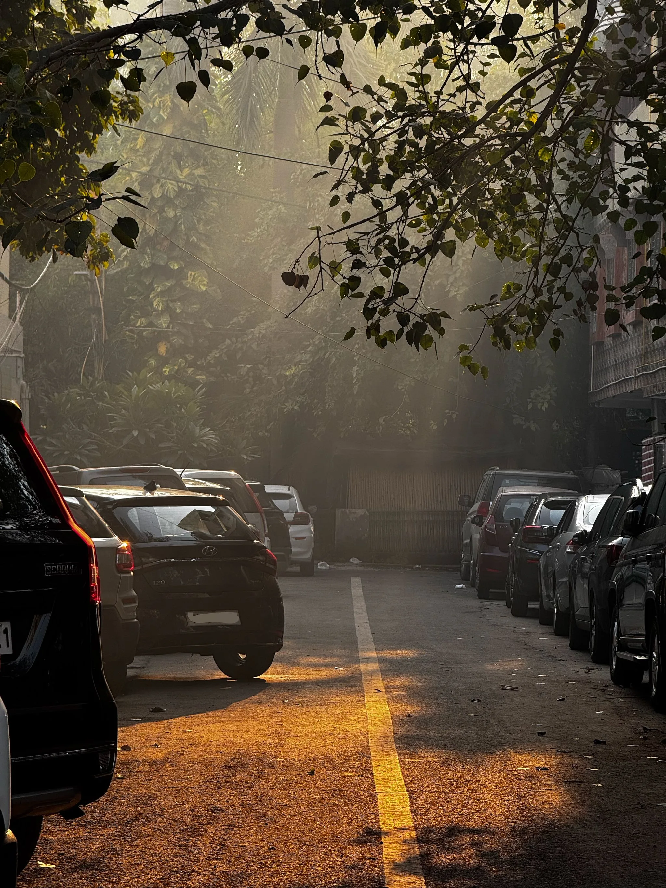
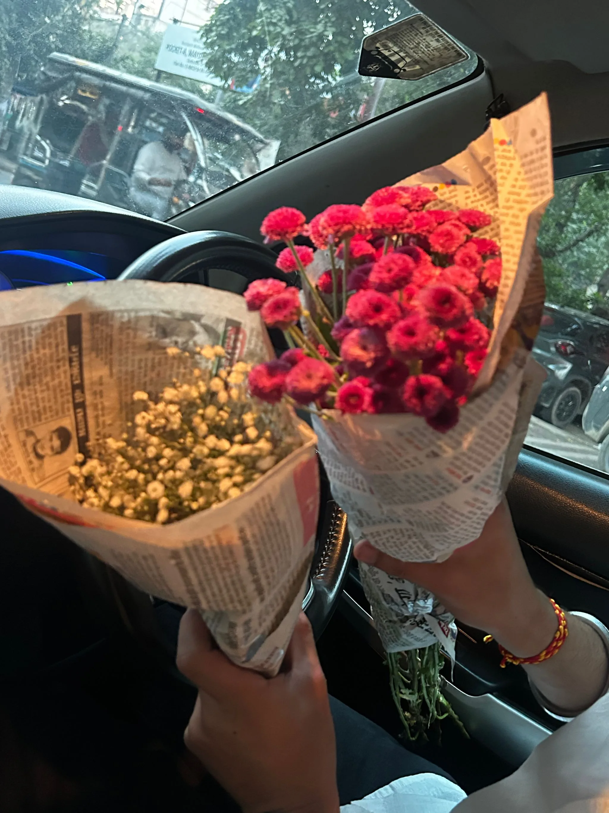
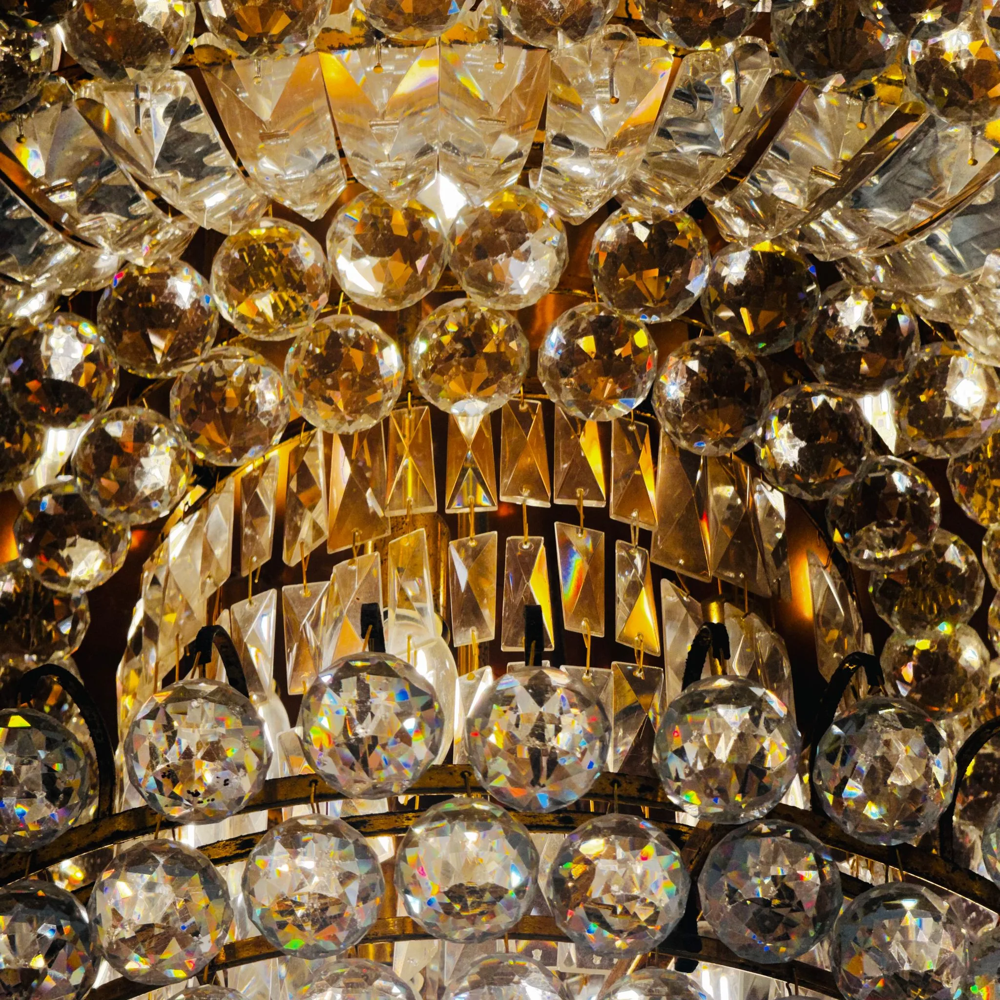

> **Day**: Seven
> **Date**: 20 November, 2026

***

# **Morning**

- Sunlight, a chill in the air and birds chirping. What a lovely start to the day, with no indication of the madness to come.
- Dropped off 50 kg of sweets at the hotel. That’s basically my sister in the form of sweets!
- One room key, one mobile phone and one bag of gifts. All the things lost and yet to be found before the clock even strikes twelve.

# Afternoon

- My sister was greeted by an AI-generated poster for her Haldi event. I will not be letting her live this down.
- Picked up flowers for my sister at her hairstylist’s request. I don’t know why we got so many. She’s tiny! (Re the sweets point above)
- More people have been inducted into the “random mid-day snacks to avoid chaos” cult. My sister ended up having two large fries today.

# Evening

- The list of last-minute things people have forgotten at home keeps growing: suits, belts, shoes, cash for payments, baby bottles.
- Three years ago, Shaoni and I had our reception at the same venue. One of the things I remember vividly from that day are the huge chandeliers.
- I debated whether the post-midnight rituals count as day seven or day eight updates. I am in no hurry to wrap up these wedding diaries, though.
