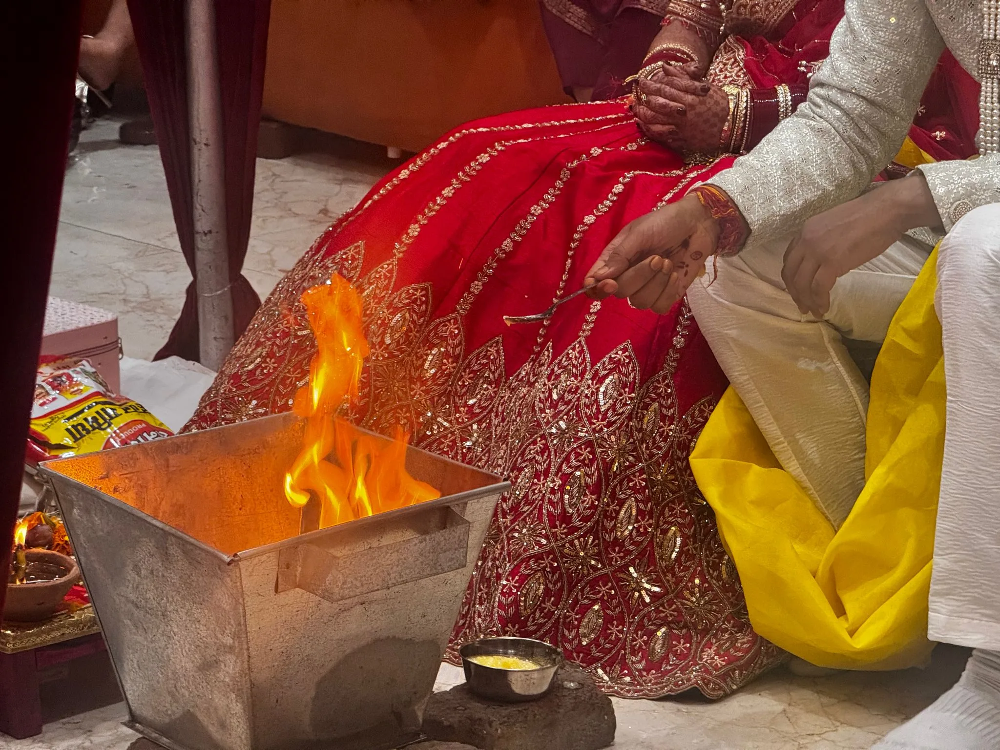
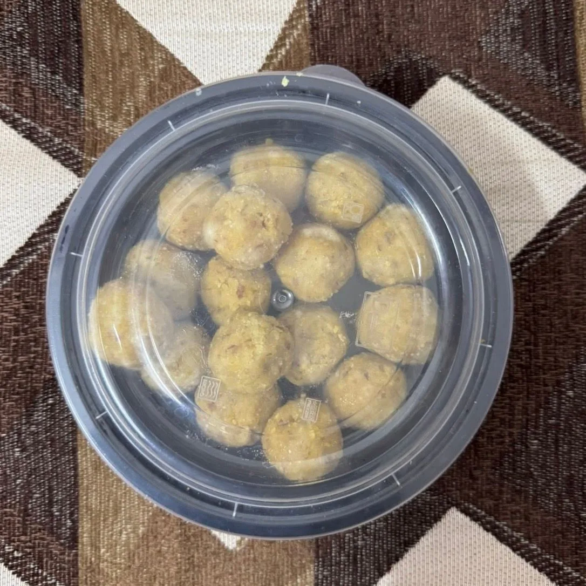
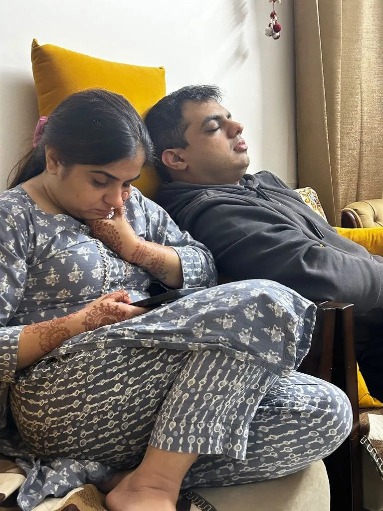

> **Day**: Eight
> **Date**: 21 November, 2026

***

# Midnight

- The wedding rituals went on till 5 am. Of course, we had forgotten more things, this time at the hotel, and had to make another run to bring them to the venue.
- The pandit who performed all the rituals was from the groom’s family. Very similar traditions to ours, with a pahadi twist to the whole affair.
- Shaoni and I went along with my sister to drop her off at the in-laws’ place. It was 9 am by the time we were back. That is 27 hours awake, if anyone is counting (I was).

# Morning

- Saw Shaoni’s parents off as they head to the mountains for a week. We got a box of tasty moong dal laddoos to gobble up!
- The rest of the morning at the hotel was spent packing up the rooms and booking Ubers for many uncles. Somewhere in between, we sneaked in a 90-minute nap to keep functioning, just about.
- Lost my credit card. Probably during the fuel stop on the way back from dropping my sister. I was half asleep at the petrol station anyway.

# Evening

- It was 2:30 pm by the time we were back home and in our beds. Came back to life around 8 pm after a deep sleep and a missed meal.
- A Punjabi wedding is never over at the wedding. There are still two more events to go and a post-wedding organising of stuff. Curse you post-wedding chores!
- The family sitting together and planning after the wedding was the most exciting hang ever.
