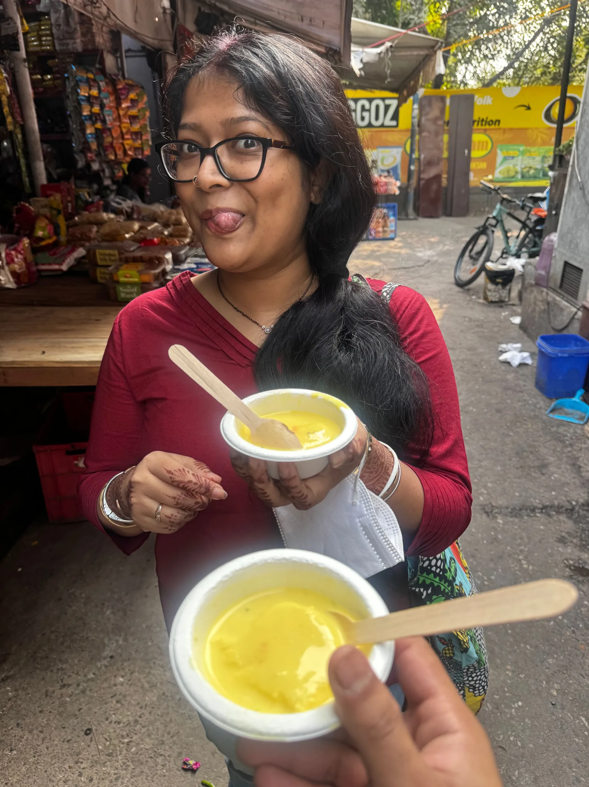
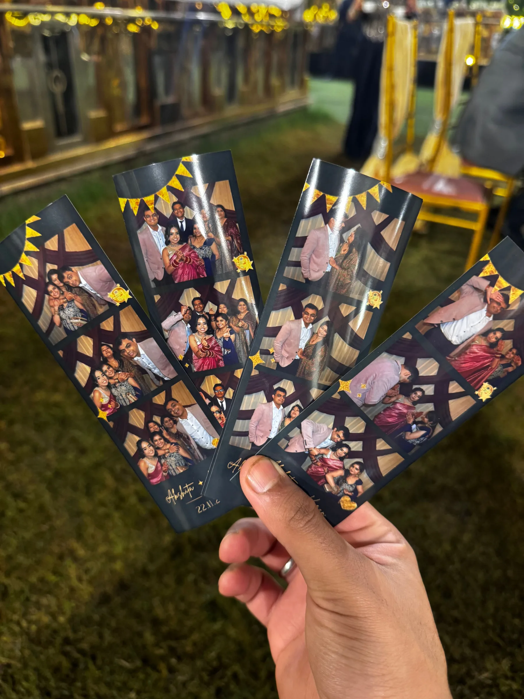

> **Day**: Nine
> **Date**: 22 November, 2026

***

# **Morning**

- The post-wedding work continues. Now it is time to put together and deliver gifts to all the “close” neighbours and relatives for being a part of the celebrations.
- There is a three-tier system for these gifts. The first tier gets a box of sweets and a bedsheet. The second gets fruit too. The final tier gets all of that, plus “lifafas” for every family member!
- In the middle of all the gift delivery runs, Shaoni and I sneaked in a mini-date. It involved a kick-ass rasmalai.

# Afternoon

- My biggest gripe with Punjabi weddings is the wastage of food. The groom’s family gifted us a fruit basket, and a third of the fruit was already beyond saving by the time we opened it. Now we are taking another basket to them, reusing some of the fruit they gave us.
- Shaoni’s online shopping skills are unmatched. When her original jewellery plans for the reception changed, she ordered something to go with her saree and it arrived in 10 minutes!
- Apparently, still not caught up on sleep. Needed another 45-minute emergency nap to function again.

# Evening

- Pros of today’s reception event: non-vegetarian food and alcohol. Cons: the venue is an hour and a half away. This is going to be another long night.
- It feels so good to attend a wedding event as a guest, not the organiser. You can enjoy the food and admire the decor without frantically running from one task to another.
- Reached home at 1 am after a long drive back. There goes my dream of an early start tomorrow for the final day of the rituals.
