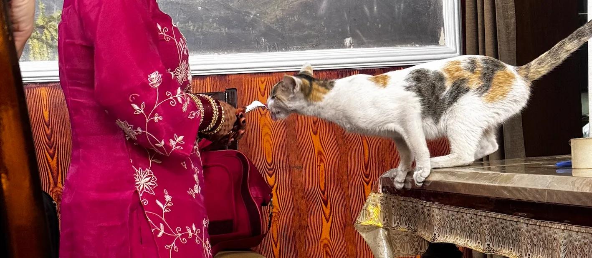
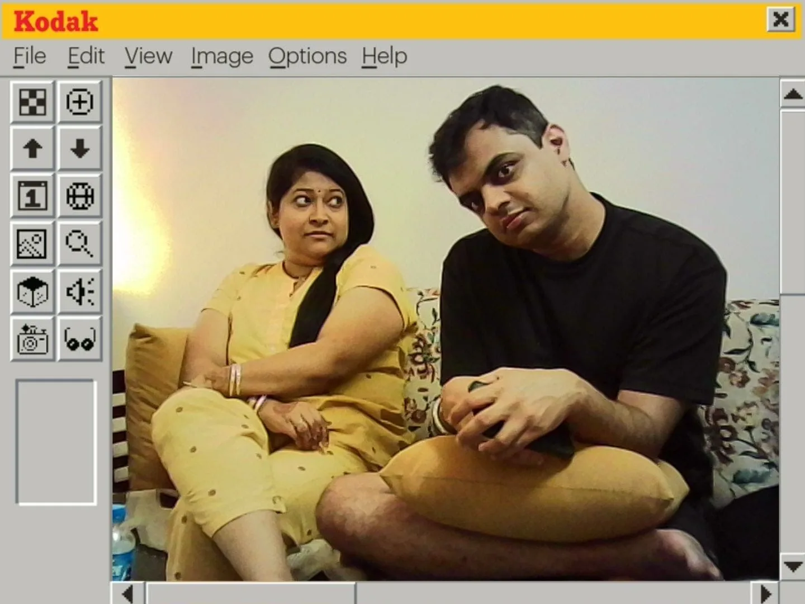

> **Day**: Ten
> **Date**: 23 November, 2026

***

# **Morning**

- Last morning at the Airbnb for Shaoni and me. While it was slightly weird staying away from the family over the last week or so, no complaints about the quiet and slow start to the mornings.
- Literally five minutes after we handed over the keys, my sister told us that she and her partner were coming home for the _pag phera_ and planned to stay the night. We ended up extending our Airbnb stay by another day and picking up the keys again.

# Afternoon

- Shaoni made some tasty chicken curry and dum aaloo for everyone! Sunday Table, Delhi edition.
- Somehow, word reached Aamchur that my sister was back home, and came over to complain about the lack of treats.

# Evening

- Took my sister’s partner for a stroll around the neighbourhood and tried our beloved mutton rolls. The evening ended with a crash course in family gossip.
- Clicked a bunch of photos with the funky new camera.

# Bonus: The next morning

- My masi and her family left at 7 am. We went along to the station, using three cars to transport four people and 12 bags. Weddings.
- Before my sister and her partner left at noon, we opened a hundred or so _lifafas_ and counted all the “gifts” we received from friends and family.
- Shaoni and I left for Bangalore around 3 pm. I am left feeling a mix of love and exhaustion. Love for all the people I have spent these 11 days with, and exhaustion from what it takes to constantly engage with this family. This was also the last wedding of our generation, so it might be a while before we all get to do this again.
