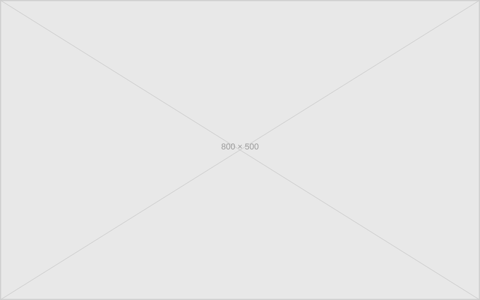

This document shows every formatting element this site can render, and how to write each one. It is a reference and a test. The content is real where it can be; instrumental where it must be. How these elements look, down to the fonts, colours and spacing, is on the [style](/style/) page.

In the CMS, the insert menu in the body editor writes the shortcodes and conventions below for you: margin note, callout, page break, footnote marker and text, image with caption, and quote with source. Everything it writes can also be typed by hand.

## Inline text

Running prose can include **bold text** for emphasis, _italic text_ for titles and stress, and ~~strikethrough~~ for corrections or retractions. These can combine: **_bold italic_** works, as does _~~struck italic~~_.

Inline `code` renders in a monospace font with a faint background. It is for short technical terms, variable names, filenames — things that need to be distinguished from prose.

Links come in two kinds. [External links](https://www.example.com/) point away from this site. [Internal links](/about/) navigate within it. Both use the standard browser link colour.

The typographer is on. This means "straight quotes" become "curly quotes" automatically. Apostrophes too: it's, they're, the '90s. A double hyphen -- becomes an em dash. Three dots... become an ellipsis.

***

## Headings

Headings here are the same size and weight as body text. Structure is in the spacing and in the words themselves, not in visual hierarchy. This is a deliberate choice.

### Third-level heading

A third-level heading, introduced by `###`. Used for subsections within a section.

#### Fourth-level heading

A fourth-level heading, `####`. Use sparingly — if you need four levels of hierarchy in a single document, the document may need restructuring.

***

## Paragraphs

A paragraph that follows another paragraph starts with an indent, as in a printed book. A paragraph that follows anything else (a heading, a list, a quote, a code block, a rule, an image or a table) starts flush left. This paragraph and the one before it show the indent.

A margin note placed between two paragraphs does not break the indent on screen.

A single line break inside a paragraph is ignored, so write one paragraph per block. Inside a blockquote a single line break is kept, which is what makes lyrics and verse work.

***

## Lists

An unordered list:

- The first item, which establishes the pattern
- A second item, continuing it
- A third item, closing the set
    - A nested item, indented one level
    - Another nested item at the same level
        - Nested two levels deep, which is usually too deep

An ordered list:

1. The first step, which must come first
2. The second step, which follows from it
3. The third step, which completes the sequence
    1. A sub-step within the third step
    2. Another sub-step

A list where items are full sentences should end each sentence with a full stop. A list where items are fragments should not. Mixing the two in a single list is the most common list error.

***

## Blockquote

A blockquote is for quotation — text that originates elsewhere. It sits behind a thin bar on the left, with no quotation marks. The source, if needed, follows as a regular paragraph.

> The test of a first-rate intelligence is the ability to hold two opposed ideas in mind at the same time and still retain the ability to function.

F. Scott Fitzgerald, _The Crack-Up_, 1936.

Line breaks inside a quote are kept, so verse can be set line by line:

> Shall I compare thee to a summer's day?
> Thou art more lovely and more temperate.

William Shakespeare, Sonnet 18, 1609.

The insert menu's quote with source writes exactly this: a quote, then the source as a plain line under it.

***

## Code block

A fenced code block, with syntax annotation:

```json
{
  "title": "A complete formatting reference",
  "date": "2026-03-26",
  "tags": ["meta", "design"]
}
```

A shell example:

```bash
npm run dev
# → Watching for changes…
# → Server at <http://localhost:8081>
```

Code blocks scroll horizontally if the content is wider than the page. They do not wrap.

***

## Table

Tables use the standard pipe syntax. Column alignment is set with colons in the separator row.

| Element | Markdown | Renders as |
| --- | --- | --- |
| Bold | `**text**` | **text** |
| Italic | `*text*` | *text* |
| Strikethrough | `~~text~~` | ~~text~~ |
| Inline code | `code` | `code` |
| Horizontal rule | `---` | * \* \* |
| Page break | `pagebreak` shortcode | grey strip |

Tables should be used for genuinely tabular data. If you find yourself merging cells or nesting tables, a list or prose is probably the right tool.



## Page break

The grey strip above is a page break. It is for long documents that are conceptually divided into pages. It renders as a full-bleed band of the desk colour, with a page counter.

Insert one with the `pagebreak` shortcode (``), on a line of its own between paragraphs. A plain `---` in the body renders as the typographic `* * *` section break, which is lighter.

***

## Image

An image, constrained to the document width:



Images are block-level. They sit on their own line with vertical spacing above and below. They do not float. Captions are not built in — a following paragraph in _italic_ can serve as one.

_An SVG placeholder standing in for a real photograph. This italic line is the caption._

The insert menu's image with caption writes this pair: the image, then an italic line under it. Uploaded JPEG, PNG and HEIC files are converted to WebP when the site is built.

***

## Callout


A note callout. Write it as `` and close it with ``. Use this for asides, clarifications, or additional context that is useful but not essential to the main argument. It has a faint yellow background.



A warning callout, written the same way with "warning". Use this for things the reader should be careful about — exceptions, caveats, known failure modes. It has a faint orange background.


***

## Margin note

A margin note is shown as a comment on the desk beside the page, level with the words it is about. On a narrow screen the same note opens from the bottom when you tap the highlighted text. Without JavaScript, in print and in feed readers it is an ordinary boxed paragraph in the flow of the text; in print it is numbered to match the highlighted words.

Write it directly after the paragraph it belongs to: `` ... ``. A second argument dates the note, as in ``; without one it takes the post's date. Markdown works inside a note.


This one names its phrase, so only those words are highlighted.


The paragraph that hosts a margin note should be self-contained — readable without the note. The note adds, it does not complete. This is the difference between a margin note and a footnote: margin notes are optional; footnotes are referenced.[^1]


This one names no phrase, so it is attached to the whole paragraph.


***

## Edited posts

A post can be revised in public. When it has more than one version, an edit note appears under the tags: a one-line quote such as "This post was edited on 15 Oct, 2026" ending in a [*] mark. The mark links to a footnote that says what changed, with links to a page showing what changed (red for removed text, green for added) and to the earlier versions. The titlebar's "Edited" menu lists every version. Earlier versions live at the post's address plus /v1/, and never appear in listings, tag pages or the feed.

This is set in the CMS with the Version and What changed fields, not in the body, so there is nothing to type here.

***

## Custom IDs via attrs

The `markdown-it-attrs` plugin lets you attach HTML attributes to any block element by appending them in curly braces. The most useful case is overriding the auto-generated heading slug for stable deep links:

```markdown
## My Heading { #custom-id }
## My Heading { .custom-class }
## My Heading { data-foo="bar" }
```

Note: because this site processes Nunjucks before markdown, ID attrs must be written with a space before the hash — `{ #id }` rather than the collapsed form. Class and data attributes (`{.class}`, `{data-x="y"}`) have no such restriction.

***

## Footnotes

Footnotes are numbered automatically and linked bidirectionally.[^2] The reference appears inline as a superscript; the note appears at the bottom of the document with a return link.

They are for genuine supplementary material — citations, extended asides, qualifications that would slow the prose if embedded in it. If you find yourself writing footnotes longer than the paragraphs they annotate, reconsider whether the footnote belongs in the body or in a separate section.

[^1]: The footnote itself, demonstrating its own form. The text above references this note; this note does not assume you read the text above in order to make sense. That is the test.

[^2]: A second footnote, which the insert menu writes as a footnote marker in the text and a footnote text at the end. The numbering is automatic — add or remove footnotes anywhere in the document and the numbers update.
